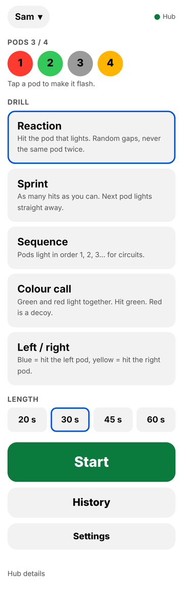
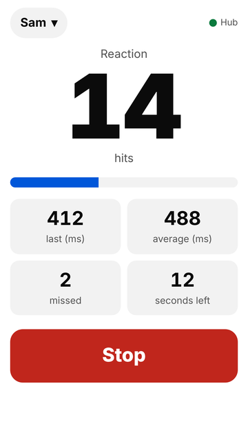
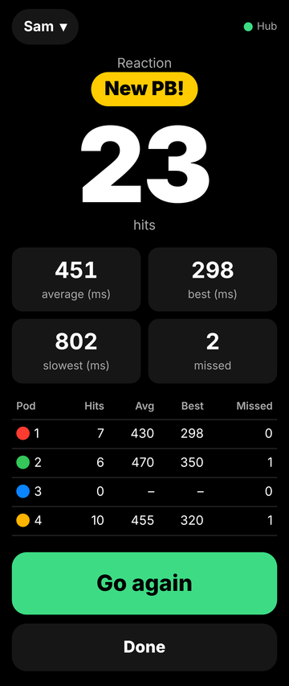
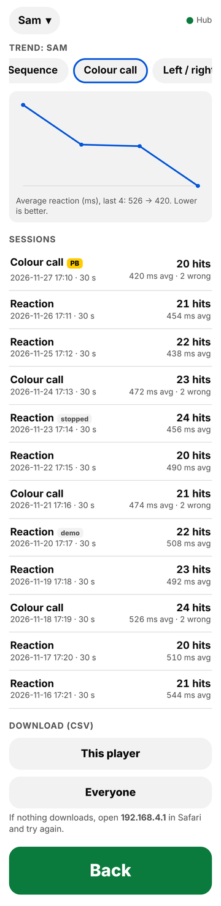

# Pod Hub

Run reaction-light drills on your BlazePods from a small M5Stack Dial: no app, no account, no subscription, no Wi-Fi needed. Turn the knob to pick a drill, press to start, and see the results on the Dial. A phone is optional.

> Pod Hub is an unofficial personal project. It isn't made by or connected with BlazePod / PLAY COYOTTA LTD.
>
> **Please don't update your pods' firmware in the official BlazePod app** once Pod Hub works. An update could change how the pods talk, and the hub would stop working with them.

---

## What you need

- An **M5Stack Dial** (with a battery fitted, or a USB-C power bank)
- Your **BlazePods** (up to 6)
- **Once, to install:** a laptop or desktop with **Chrome or Edge**, and a USB-C cable
- **Optional:** a phone, for the bigger screen, history and downloads

---

## 1. Install Pod Hub (once)

1. On the computer, open the installer page: **<https://moochin.github.io/moochin-pod/>**
2. Plug the Dial in with the USB-C cable.
3. Click **Install** and choose the Dial (**USB JTAG/serial debug unit**).
4. The first time, tick **Erase device**. Then click **Install** and wait about a minute.
5. Unplug the Dial. That's it: you won't need the computer again. Updates come over Wi-Fi (see [Updating](#updating)).

---

## 2. Every training session

1. **Close the BlazePod app** on your phone (or switch Bluetooth off). Pods connected to the app can't be seen by the hub.
2. **Switch the pods on**, then **switch the Dial on**.
3. Wait a few seconds. Each pod flashes its number colour as it connects (1 red, 2 green, 3 blue, 4 yellow), and its dot lights up around the edge of the Dial.
4. **Turn the knob** to choose a drill, then **press the Dial** to start. You get a 3-2-1 countdown with beeps, then go.
5. While it runs you see the hits, the last reaction time, and a ring showing the time left. **Press** to stop early.
6. At the end the Dial shows hits, average, best and misses, and **PB!** if you beat your best. **Turn** to see each pod, **press** to go back.

The beeps help when a pod is behind you: a short beep when a pod lights, a double beep for a miss, a low buzz for the wrong pod, and rising notes at the end.

---

## The drills

| Drill | What happens |
|---|---|
| **Reaction** | One pod lights white. Hit it. The next one lights 0.5 to 2 s later, never the same pod twice in a row. |
| **Sprint** | As many hits as you can. The next pod lights straight away. |
| **Sequence** | Pods light in order 1, 2, 3, 4. Good for conditioning circuits. |
| **Colour call** | A **green** and a **red** pod light together. Hit green. Red is a decoy: hitting it counts as **wrong**. Like reading the defence. |
| **Left / right** | One pod on each side lights. **Blue = hit the left one, yellow = hit the right one.** |
| **Beep test** | The 20 m shuttle run. Two pods 20 m apart; at each beep, the pod to run to lights. It gets faster every level. |

You get 3 seconds per light, or it's a miss. Drills last **30 seconds** unless you change it. Reaction times are measured by the pods themselves, so they're accurate to the millisecond.

**The beep test:** put two pods **20 m apart** (the first two connected pods are the ends). Choose **Beep test**, press, then pick how to run it:

- **Tap the pods:** for one runner. Tap or kick the lit pod when you get there; it turns **green** if you made it before the beep. Not getting there in time is a warning (low tone). **Two late in a row ends the test**, as in the official rules.
- **Group, no taps:** for a few of you at once. The pods just swap with each beep; press the Dial (or Stop on the phone) when you're done.

Every beep is a new shuttle; a **triple beep** means a new level. The score is shown as **level.shuttle** (e.g. 8.4), with the distance in metres. The timings follow the standard 20 m test: level 1 at 8.0 km/h, level 2 at 9.0 km/h, then 0.5 km/h faster each level, up to level 21.

**Setting up left and right:** place the pods, then go to **Menu → Left/right pods**. Left pods glow blue and right pods yellow. **Tap a pod to swap its side**, then press the Dial to save.

---

## The menu

**Hold the Dial down for 3 seconds.** Turn to move, press to change.

| Item | What it does |
|---|---|
| Player | Who's training (results and PBs are kept per player) |
| Drill length | 20, 30, 45 or 60 seconds |
| Left/right pods | Set which pods are on which side |
| Sound | Beeps on or off |
| Brightness | 1 to 4 |
| Phone mode | Turns on the hub's own Wi-Fi for a phone (see below) |
| Find pods again | Forget the pods and search again (e.g. after swapping a pod) |
| Auto switch-off | Switch off after 5, 10, 15 or 30 minutes unused, or never |
| Demo pods | Pretend pods, to try things out without real ones |
| Switch off | Turns the Dial off |

---

## Using a phone (optional)

1. On the Dial: **Menu → Phone mode**. A QR code appears.
2. Point the phone's camera at it and tap **Join "PodHub"**. The Pod Hub page opens by itself. If it doesn't, open the browser and go to **192.168.4.1**.
3. Start and stop drills, pick the drill and length, watch the live numbers, see results for each pod, and tap **Go again**. The phone and the Dial stay in step.
4. Tap the **player name** at the top to choose who's training or **rename players**.
5. **History** shows past sessions and a trend for each drill. **Download (CSV)** gives you a spreadsheet. If the download doesn't start, open 192.168.4.1 in Safari and try again.
6. **Settings** covers sound, brightness, auto switch-off, how many pods to look for, demo pods, updating, and starting again.

The hub's Wi-Fi only runs in phone mode, and needs no internet or home Wi-Fi. The first time a phone connects it also sets the Dial's clock, so sessions are saved with the date and time.

---

## Players, personal bests and history

- Up to **4 players**. Choose under **Menu → Player** or on the phone.
- **Personal bests** are kept per player, per drill and per drill length: lowest average for Reaction, Colour call and Left / right, most hits for Sprint and Sequence.
- **Every session is saved**, with every hit, miss and wrong pod. The latest 200 are kept.
- Demo-pod sessions never count as personal bests.

---

## Switching off and the battery

- **Menu → Switch off**, then press to confirm. On battery, this cuts the power. Switch it back on the way you normally do.
- It **switches itself off after 15 minutes unused**, with a 30-second countdown first; press or turn to keep it on. It never switches off during a drill or while a phone is connected.
- On USB power the Dial can't switch itself off. The screen just goes dark until you unplug it.
- The Dial can't measure its battery, so there's no battery level. Charge it after each session.

---

## Updating

No cable needed:

1. On your phone, open **<https://moochin.github.io/moochin-pod/>** and tap **Download podhub-update.bin**.
2. On the Dial, turn on **Menu → Phone mode** and join **PodHub**.
3. On the Pod Hub page, open **Settings → Update the hub**, choose the file you downloaded, and tap **Update**.
4. The Dial shows the progress and restarts by itself. Your pods, players and history are kept.

You can also reinstall over USB from the installer page any time. Leave **Erase device** unticked to keep everything.

---

## If something's not right

| Problem | Try this |
|---|---|
| Pods don't connect (grey dots) | Close the BlazePod app or turn off the phone's Bluetooth. Switch the pods off and on. **Menu → Find pods again**. |
| One pod keeps dropping | Move it closer. Check its battery. |
| A pod's dot stays **dark red** | It connects but won't respond. It may have new firmware from the BlazePod app that the hub doesn't understand. |
| Phone page doesn't open | Make sure phone mode is on and the phone is on **PodHub**, then open **192.168.4.1** in the browser. |
| The phone leaves PodHub | It's looking for internet. Open the Pod Hub page once, and it should then stay. |
| Something is muddled | **Settings → Factory reset** on the phone starts completely fresh. The hub then finds the pods again by itself. |

---

For developers: see [DEVELOPING.md](DEVELOPING.md).
